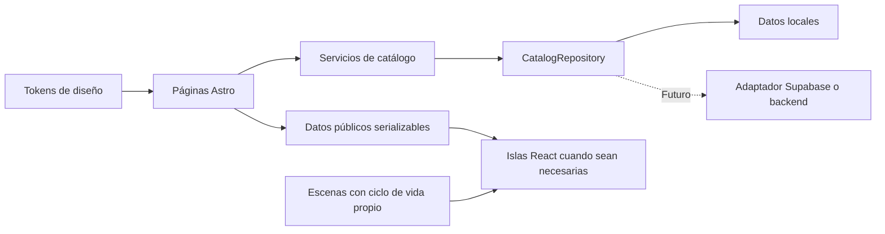

# Arquitectura de AROMAFIA

Decisión: **2 de noviembre de 2026**. Alcance: fundamentos técnicos del catálogo; el diseño visual y las escenas definitivas se definirán en una fase posterior.

## Decisión

Usar **Astro 7.4.5, React 19 y TypeScript estricto**, con generación estática y componentes React únicamente donde una interacción lo justifique. El archivo de bloqueo es la referencia de las versiones efectivamente instaladas.

El catálogo empieza como un sitio de contenido: sus páginas necesitan mostrar información real, cargar rápido e indexarse cuando se publiquen. Astro permite producir HTML durante el build y activar JavaScript en componentes concretos mediante su arquitectura de islas. La integración de React deja disponible su ecosistema sin obligar a hidratar toda la página. [Arquitectura de islas de Astro](https://docs.astro.build/en/concepts/islands/), [integración oficial de React](https://docs.astro.build/en/guides/integrations-guide/react/).

Esta elección responde a las necesidades actuales. No significa que Astro sea siempre más rápido que otra opción: el tamaño de las imágenes, la hidratación, el código de las escenas y las decisiones de carga deberán medirse sobre cada implementación.

## Comparación evaluada

| Criterio                   | Astro + React + TypeScript                                              | Next.js + TypeScript                                                                    | React + Vite + TypeScript                                                               |
| -------------------------- | ----------------------------------------------------------------------- | --------------------------------------------------------------------------------------- | --------------------------------------------------------------------------------------- |
| Catálogo inicial y SEO     | HTML estático por defecto, apropiado para contenido público             | SSG y SSR integrados; buena opción para contenido y aplicaciones                        | El punto de partida SPA requiere añadir prerenderizado o SSR y resolver el routing      |
| JavaScript del visitante   | Hidratación optativa por componente                                     | Se deben controlar las fronteras servidor/cliente y la navegación React                 | Habitualmente la aplicación cliente participa en el renderizado del contenido           |
| Animaciones avanzadas      | Compatible con GSAP, DOM, SVG e islas React                             | Compatible con GSAP y animación de componentes React                                    | Compatible con los mismos motores; Vite no determina el diseño de las escenas           |
| Evolución a comercio       | Puede incorporar rutas dinámicas y un adapter cuando hagan falta        | Capacidades completas de servidor, apropiadas para una aplicación transaccional extensa | Exige elegir e integrar más piezas para servidor, SEO y datos                           |
| Cloudflare                 | Assets estáticos portables; adapter oficial para SSR futuro             | Cloudflare recomienda vinext, actualmente beta                                          | Hosting estático sencillo; SSR depende de la integración elegida                        |
| Complejidad para esta fase | Ajustada al catálogo con interactividad selectiva                       | Más decisiones de aplicación de las necesarias hoy                                      | Base pequeña, pero más infraestructura propia para alcanzar los requisitos de contenido |
| Operación y costos         | No requiere cómputo de aplicación por visita para las páginas estáticas | Depende de las funciones de servidor utilizadas y de la plataforma                      | Bajo costo operativo como SPA estática; sumar SSR cambia ese escenario                  |

Next.js admite una exportación estática y una evolución posterior a funciones de servidor, pero su modo estático limita capacidades que dependen de solicitudes dinámicas. Vite proporciona una API de SSR de bajo nivel, orientada especialmente a quienes construyen frameworks o integraciones. Esas posibilidades son válidas, aunque no reducen la complejidad del caso inicial de AROMAFIA. [Exportación estática de Next.js](https://nextjs.org/docs/app/guides/static-exports), [SSR en Vite](https://vite.dev/guide/ssr).

No se contratan servicios ni se estiman costos futuros como si fueran constantes. Los límites, precios y necesidades de almacenamiento se revisarán con el tráfico y el catálogo reales.

## Un solo proyecto con módulos claros

La aplicación se organiza como un **monolito modular**: un repositorio y un build, con responsabilidades separadas. No necesita microservicios, colas, un backend independiente ni una base de datos en esta etapa.

| Responsabilidad          | Regla                                                                                           |
| ------------------------ | ----------------------------------------------------------------------------------------------- |
| Páginas y layouts Astro  | Componen el documento, sus metadatos y los datos públicos necesarios para renderizar            |
| Componentes compartidos  | Reciben propiedades; no conocen el proveedor de datos                                           |
| Islas React              | Gestionan únicamente interacciones que necesitan estado o composición React                     |
| Sistema de diseño        | Define tokens semánticos, tipografía, estados y reglas de movimiento                            |
| Dominio del catálogo     | Define productos, variantes, dinero, disponibilidad y reglas independientes del framework       |
| Repositorio del catálogo | Expone contratos para consultar datos sin acoplar las páginas al almacenamiento                 |
| Servicios                | Coordinan casos de uso; no manipulan timelines ni estilos                                       |
| Animaciones              | Trabajan sobre una raíz y recursos propios; no modifican precios, disponibilidad ni publicación |
| Recursos de marca        | Conservan originales y distinguen las derivaciones aprobadas                                    |
| Tests y documentación    | Verifican comportamientos y registran decisiones y límites reales                               |

Las islas reciben datos públicos mínimos. No deben importar módulos de servidor, credenciales ni repositorios que contengan datos no publicados. Los datos de prueba viven en tests. Los seis perfumes se prepararon en fase 2 y en fase 3 se habilitaron expresamente para el catálogo local. Su contenido sigue pendiente: la UI identifica fotografías/presentaciones por confirmar y no inventa especificaciones. Los borradores y las propuestas de autoría siguen excluidos de resultados públicos.

## Datos e integraciones futuras

`CatalogRepository` es el punto de sustitución del origen de datos. La implementación local permite trabajar sin red ni cuentas. Una implementación remota posterior deberá cumplir el mismo contrato y transformar la respuesta del proveedor al modelo del dominio.

El dinero se representa con moneda y unidades menores enteras para evitar errores de coma flotante. Las capacidades, SKU, precio y disponibilidad pertenecen a las variantes que correspondan; no se infieren de una fotografía o de un nombre comercial. Un dato desconocido debe seguir siendo desconocido. No se inventan promociones, stock, reseñas ni descuentos.

La evolución prevista es incremental:

1. **Catálogo local publicado:** datos verificados, páginas y URLs estables, imágenes optimizadas y consulta accesible.
2. **Contenido administrado:** reemplazar el repositorio local por Supabase u otro backend; decidir entre reconstrucciones estáticas y rutas dinámicas según la frecuencia real de cambios.
3. **Medios administrados:** incorporar R2 si hace falta almacenar o cargar archivos; conservar referencias de medios independientes del proveedor.
4. **Comercio:** añadir carrito, precios autoritativos de servidor, reserva de inventario, checkout, webhooks idempotentes y pedidos cuando se definan las reglas comerciales.
5. **Clientes y administración:** incorporar autenticación, permisos y auditoría cuando existan esos flujos.

Reutilizar los contratos reduce el acoplamiento; **no promete que el comercio pueda añadirse sin cambios**. Las transacciones, los permisos, la consistencia de inventario y los pagos requieren nuevos casos de uso y validación de servidor. Astro documenta la incorporación de [renderizado bajo demanda](https://docs.astro.build/en/guides/on-demand-rendering/) y una [integración con Supabase](https://docs.astro.build/en/guides/backend/supabase/). Cloudflare ofrece [acceso a R2 desde Workers](https://developers.cloudflare.com/r2/api/workers/workers-api-usage/).

## Sistema de movimiento

El conjunto inicial es **CSS + GSAP**. ScrollTrigger forma parte del mismo paquete de GSAP y se carga únicamente en las escenas que lo requieran. Motion y Three.js se mantienen fuera de las dependencias hasta que una necesidad concreta justifique incorporarlos.

- CSS resuelve focus, hover, estados y transiciones sencillas.
- GSAP permite secuencias coordinadas y escenas sobre DOM o SVG.
- La carga del motor es dinámica y está separada del contenido y de la lógica del catálogo.
- Cada escena tiene una raíz, inicialización y limpieza. Los listeners, observers y tareas asíncronas también deben cancelarse.
- Una propiedad animada tiene un solo responsable: no combinar una transición CSS y una timeline sobre el mismo `transform`.
- `prefers-reduced-motion` mantiene contenido y funcionalidad completos, sin desplazamientos decorativos obligatorios.
- La salida de una vista, los cambios de breakpoint y el desmontaje restauran los recursos de la escena. Se suspenden efectos fuera de pantalla y en documentos ocultos.
- El contenido permanece legible si el motor no carga o si JavaScript está deshabilitado.

`gsap.matchMedia()` permite adaptar escenas a consultas de medios y revertir los recursos asociados al cambiar de condición. En futuras escenas React, `useGSAP` es una opción oficial para gestionar el contexto, pero no elimina la responsabilidad de retirar listeners propios y proteger callbacks diferidos. [GSAP matchMedia](<https://gsap.com/docs/v3/GSAP/gsap.matchMedia()/>), [GSAP con React](https://gsap.com/resources/React/).

La selección de herramientas prepara la infraestructura; no autoriza escenas definitivas, scroll bloqueado, una introducción obligatoria ni WebGL decorativo. La animación v3 aprobada y el PNG oficial se conservan como referencias; su incorporación a una futura página necesita una decisión de diseño específica.

## SEO y estado de esta base

La fase 3 muestra el catálogo editorial local, todavía con fotografías y especificaciones pendientes.
`PUBLIC_SITE_INDEXABLE` permanece en `false` por defecto. `PUBLIC_SITE_URL` es opcional durante el
trabajo local; no se debe sustituir por un dominio ficticio en metadatos emitidos.

Cuando haya un dominio real y contenido publicable, se habilitarán las URLs canónicas, sitemap y metadatos coherentes con ese origen. Las futuras fichas conservarán slugs estables. Los datos estructurados se producirán únicamente a partir de información real y visible.

## Compatibilidad y decisiones aplazadas

La configuración actual produce archivos estáticos. No instala un adapter de servidor, CLI de despliegue, SDK de Supabase, pasarela de pagos ni infraestructura de R2.

La petición posterior del **3 de noviembre de2026** prepara **Cloudflare Pages estático**. Se
conserva el build de Astro y se añade `build:pages`, que comprueba el artefacto `dist/` antes de
subirlo. La entrega incluye un ZIP para carga manual y una guía de configuración Git; no crea
recursos remotos ni publica. La discusión anterior de Workers y su CLI queda como investigación
histórica, sin condicionar la preparación actual. [Configuración vigente](deployment.md).

Al 2 de noviembre de 2026, `cf` está en beta y Cloudflare advierte que Astro 6 y posteriores no construyen con su flujo automático durante esa beta. El build de este proyecto se realiza con Astro. La publicación se validará en la fase correspondiente; véase [despliegue](deployment.md). [Limitación oficial de cf](https://developers.cloudflare.com/cf/get-started/first-worker/).

Para Next.js en Workers, Cloudflare recomienda actualmente vinext y señala que está en beta. No se incorpora esa capa adicional en este proyecto. [Next.js en Cloudflare Workers](https://developers.cloudflare.com/workers/framework-guides/web-apps/nextjs/).

Antes de añadir una dependencia o servicio, registrar qué necesidad resuelve, su alternativa más sencilla, su costo de JavaScript y mantenimiento, y cómo se verifica. El brief visual está en `catalog-visual-phase-1.md`; la fase 3 implementa la composición editorial sin añadir dependencias. La página se renderiza en Astro sin islas hidratadas ni JavaScript cliente. Las mejoras actuales de entrada/hover usan CSS y respetan movimiento reducido; GSAP permanece preparado para escenas posteriores.
